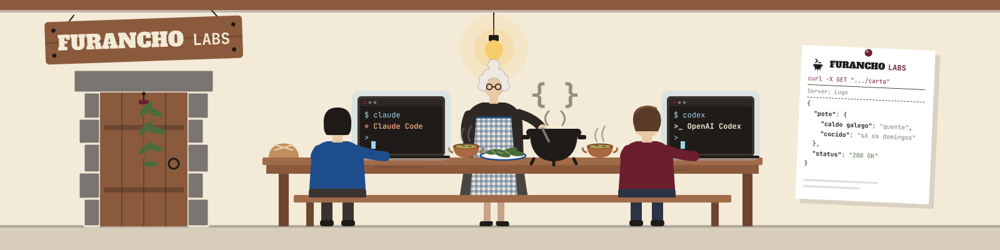

  

  <b>We code here, but first we eat.</b> 
  Side projects by two devs from Galicia. No roadmap, no rush.

---

### 🌿 What is this?

A *furancho* is a family home in Galicia that opens its doors every now and then
to serve home-cooked food, marked by a laurel branch hanging on the door.
This is the same thing, but with code: we open when we feel like it
and serve whatever we've been cooking.

### 🍲 Today's menu

> 🥄 **Coming soon.** The first dishes are still on the stove.
> Check back shortly, grandma has already put the pot on the fire.

### 👨‍🍳 In the kitchen

| | |
|---|---|
| [@santisoutoo](https://github.com/Santisoutoo) | Developer |
| [@VforVitorio](https://github.com/VforVitorio) | Developer |

---

  Made in Galicia, with hot broth and <code>git push</code>.

